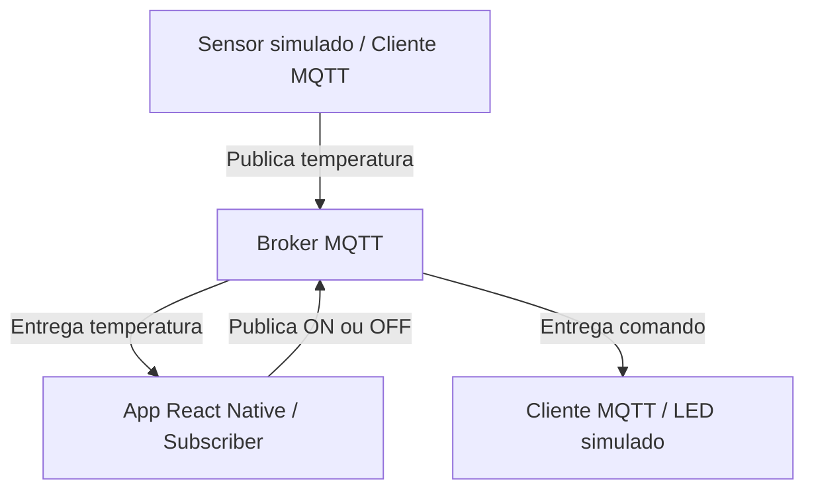

# MQTT com React Native, Expo e TypeScript

**Disciplina:** Mobile Development & IoT  

## 1. Objetivos de aprendizagem

Ao final da aula, os alunos deverão ser capazes de:

- Explicar MQTT e sua aplicação em dispositivos móveis e IoT.
- Diferenciar MQTT de HTTP/REST.
- Identificar os papéis de **Publisher**, **Subscriber**, **Broker** e **Topic**.
- Conectar um aplicativo React Native a um broker MQTT por WebSocket.
- Publicar e receber mensagens em tempo real.
- Simular sensores e atuadores sem hardware físico.
- Implementar um painel de temperatura e controle de LED virtual.

## 2. Visão geral e arquitetura

O projeto **IoT Monitor** acompanha a temperatura de um ambiente e publica comandos para um LED virtual.



O aplicativo não se comunica diretamente com o sensor. Os clientes publicam e assinam tópicos por intermédio do broker.

## 3. Roteiro da aula (150 minutos)

| Atividade |
|---
| Introdução ao MQTT e comparação com HTTP/REST 
| Broker, tópicos, QoS, mensagens retidas e Last Will 
| Demonstração de publicação e assinatura via navegador 
| Configuração do Expo e implementação do serviço MQTT 
| Interface de temperatura e controle do LED 
| Exercícios 

## 4. Conceitos fundamentais

- **MQTT (Message Queuing Telemetry Transport):** protocolo leve de mensagens, amplamente utilizado em IoT.
- **Broker:** servidor que recebe mensagens e as distribui aos clientes inscritos.
- **Publisher:** cliente que publica uma mensagem.
- **Subscriber:** cliente inscrito em um tópico para receber mensagens.
- **Topic:** canal lógico hierárquico, por exemplo `fiap/mobile-iot/turma01/temperatura`.
- **Publish/Subscribe:** modelo de comunicação desacoplado: quem publica não precisa conhecer os assinantes.
- **WebSocket:** transporte que pode carregar MQTT em ambientes web; não é sinônimo de MQTT.

### 4.1. QoS (Quality of Service)

| QoS | Semântica | Observação |
|---|---|---|
| 0 | No máximo uma entrega | Pode perder mensagens |
| 1 | Pelo menos uma entrega | Pode haver duplicatas |
| 2 | Exatamente uma entrega no protocolo | Maior custo de comunicação |

QoS não garante que uma ação física foi executada; para isso, o dispositivo precisa enviar uma confirmação própria.

### 4.2. Retained Message e Last Will

- **Retained Message:** o broker armazena a última mensagem marcada como retida em um tópico e pode entregá-la a novos assinantes.
- **Last Will and Testament (LWT):** mensagem configurada para o broker publicar em situações de desconexão inesperada.

### 4.3. MQTT x HTTP/REST

| Característica | MQTT | HTTP/REST |
|---|---|---|
| Modelo típico | Publish/Subscribe | Requisição/Resposta |
| Recebimento contínuo | Nativo por assinatura | Requer polling ou tecnologia complementar |
| Overhead de mensagens | Geralmente baixo | Geralmente maior |
| IoT | Muito utilizado | Também possível |
| React Native | Compatível, com atenção ao transporte | Compatível |

## 5. Tecnologias e requisitos

- Node.js e npm instalados.
- Editor como VS Code.
- Expo com template `blank-typescript`.
- React Native + TypeScript.
- Biblioteca `mqtt` (MQTT.js).
- Navegador moderno para executar **Expo Web**.
- Cliente de testes: [HiveMQ WebSocket Client](https://www.hivemq.com/demos/websocket-client/).
- Broker público de testes: `broker.hivemq.com` via `wss://broker.hivemq.com:8884/mqtt`.

> **Importante:** o broker público é compartilhado, pode apresentar indisponibilidade e não deve receber dados pessoais ou confidenciais. Utilize um identificador de turma/grupo exclusivo nos tópicos. O código abaixo prioriza o **Expo Web**; para Android e iOS nativos, valide a compatibilidade do MQTT.js e eventuais polyfills/configurações antes da aula. Não pressuponha funcionamento idêntico no Expo Go.

## 6. Criando o projeto

No terminal:

```bash
npx create-expo-app@latest IoTMonitor --template blank-typescript
cd IoTMonitor
npx expo install mqtt
npx expo start --web
```

Se necessário, instale as dependências de web indicadas pelo Expo:

```bash
npx expo install react-dom react-native-web @expo/metro-runtime
```

Estrutura sugerida:

```text
IoTMonitor/
├── App.tsx
├── src/
│   ├── services/
│   │   └── mqttService.ts
│   └── screens/
│       └── MonitorScreen.tsx
├── package.json
└── tsconfig.json
```

## 7. Serviço MQTT

Crie o arquivo **`src/services/mqttService.ts`**:

```typescript
import mqtt from "mqtt";
import type { ISubscriptionGrant, MqttClient } from "mqtt";

const BROKER_URL = "ws://broker.hivemq.com:8000/mqtt";

// Use o mesmo tópico-base no aplicativo e no dispositivo IoT.
// Em um broker público, substitua "turma01" por um identificador exclusivo.
const BASE_TOPIC = "fiap/mobile-iot/turma01";

export const TOPIC_TEMP = `${BASE_TOPIC}/temperatura`;
export const TOPIC_LED = `${BASE_TOPIC}/led`;

let client: MqttClient | null = null;

function assinaturaFoiAceita(grants?: ISubscriptionGrant[]): boolean {
  return Boolean(
    grants?.length && grants.every(({ qos }) => qos !== 128)
  );
}

export function conectarMQTT(onTemperatura: (valor: number) => void, onStatus: (status: string) => void, onLed: (ligado: boolean) => void): MqttClient {
  
  desconectarMQTT();
  
  onStatus("Conectando...");

  const mqttClient = mqtt.connect(BROKER_URL, {
    clientId: `fiap_mobile_${Math.random().toString(16).slice(2, 10)}`,
    clean: true,
    keepalive: 60,
    reconnectPeriod: 5000,
    connectTimeout: 30000,
    resubscribe: false,
    forceNativeWebSocket: true,
  });

  client = mqttClient;

  mqttClient.on("connect", () => {

    if (client !== mqttClient) return;

    onStatus("Conectado");

    console.log("MQTT conectado ao broker", {
      broker: BROKER_URL,
      topicos: [TOPIC_TEMP, TOPIC_LED],
    });

    mqttClient.subscribe([TOPIC_TEMP, TOPIC_LED], { qos: 0 }, (error, grants) => {

      if (client !== mqttClient) return;

      if (error || !assinaturaFoiAceita(grants)) {
        console.error("Erro ao assinar tópico:", error ?? grants);
        onStatus("Erro ao assinar tópico");
        return;
      }

      console.log("Inscrições MQTT aceitas:", grants?.map(({ topic, qos }) => ({ topic, qos })));
    });

  });


  mqttClient.on("message", (topic, payload, packet) => {

    if (client !== mqttClient) return;

    const mensagem = payload.toString().trim();

    console.log("Mensagem MQTT recebida", {
      topic,
      payload: mensagem,
      qos: packet.qos,
      retain: packet.retain,
    });

    if (topic === TOPIC_LED) {

      const comando = mensagem.toUpperCase();

      if (comando === "ON" || comando === "OFF") {
        onLed(comando === "ON");
      } else {
        console.warn("Comando de LED inválido recebido:", mensagem);
      }

      return;
    }

    if (topic !== TOPIC_TEMP) return;

    const temperatura = Number(mensagem);

    if (Number.isFinite(temperatura)) {
      onTemperatura(temperatura);
    } else {
      console.warn("Temperatura inválida recebida:", mensagem);
    }

  });

  mqttClient.on("reconnect", () => {

    if (client !== mqttClient) return;
    
    onStatus("Reconectando...");

  });

  mqttClient.on("offline", () => {

    if (client !== mqttClient) return;
    
    onStatus("Offline");

  });


  mqttClient.on("error", (error) => {

    if (client !== mqttClient) return;
    
    console.error("Erro MQTT:", error.message);
    
    onStatus(`Erro: ${error.message}`);
  
  });


  mqttClient.on("close", () => {

    if (client !== mqttClient || mqttClient.reconnecting) return;
    
    onStatus("Desconectado");

  });

  return mqttClient;
}

export function publicarLED(ligado: boolean): Promise<boolean> {

  const mqttClient = client;

  if (!mqttClient?.connected) {

    console.warn("Não foi possível publicar: MQTT desconectado");
    
    return Promise.resolve(false);
  }

  const mensagem = ligado ? "ON" : "OFF";

  return new Promise((resolve) => {

    mqttClient.publish(TOPIC_LED, mensagem, { qos: 1, retain: true }, (error) => {

        if (error) {
          console.error("Erro ao publicar comando LED:", error);
          resolve(false);
          return;
        }

        console.log(`Comando publicado: ${mensagem}`);

        resolve(true);
      }
    );

  });
}

export function publicarTemperatura(temperatura: number): Promise<boolean> {

  const mqttClient = client;

  if (!mqttClient?.connected || !Number.isFinite(temperatura)) {

    console.warn("MQTT desconectado ou temperatura inválida");
    
    return Promise.resolve(false);
  
  }

  return new Promise((resolve) => {

    mqttClient.publish(TOPIC_TEMP, temperatura.toString(), { qos: 1, retain: false },
      (error) => resolve(!error)
    );

  });
}

export function mqttEstaConectado(): boolean {
  return client?.connected ?? false;
}

export function desconectarMQTT(): void {

  const mqttClient = client;
  
  client = null;

  if (!mqttClient) return;

  mqttClient.end(true);
  
  console.log("MQTT desconectado");
}

```

## 8. Tela de monitoramento

Crie **`src/screens/MonitorScreen.tsx`**:

```tsx
import { useEffect, useState } from "react";
import { Alert, Button, StyleSheet, Text, View } from "react-native";
import {
  conectarMQTT,
  desconectarMQTT,
  publicarLED,
} from "../services/mqttService";

export function MonitorScreen() {
  const [temperatura, setTemperatura] = useState<number | null>(null);
  const [status, setStatus] = useState("Conectando...");
  const [led, setLed] = useState(false);
  const [publicando, setPublicando] = useState(false);

  const conectado = status === "Conectado";

  useEffect(() => {
    conectarMQTT(setTemperatura, setStatus, setLed);
    return desconectarMQTT;
  }, []);

  async function alternarLED() {

    const novoEstado = !led;
    
    setPublicando(true);

    const publicado = await publicarLED(novoEstado);
    
    setPublicando(false);

    if (publicado) {
      setLed(novoEstado);
      return;
    }

    Alert.alert("Falha ao enviar comando",  "Verifique a conexão com o broker MQTT e tente novamente.");
  }

  return (
    <View style={styles.container}>
      <Text style={styles.titulo}>IoT Monitor</Text>

      <Text style={styles.status}>Status: {status}</Text>

      <Text style={styles.temperatura}>
        {temperatura === null ? "-- °C" : `${temperatura} °C`}
      </Text>

      <Text style={styles.led}>LED: {led ? "Ligado" : "Desligado"}</Text>

      <Button
        title={
          publicando
            ? "Enviando..."
            : led
              ? "Desligar LED"
              : "Ligar LED"
        }
        onPress={alternarLED}
        disabled={!conectado || publicando}
        color={led ? "#6b7280" : "#2563eb"}
      />
    </View>
  );
}

const styles = StyleSheet.create({
  container: {
    flex: 1,
    justifyContent: "center",
    alignItems: "center",
    padding: 24,
    gap: 20,
    backgroundColor: "#f5f5f5",
  },
  titulo: {
    fontSize: 28,
    fontWeight: "bold",
  },
  status: {
    fontSize: 16,
  },
  temperatura: {
    fontSize: 48,
    fontWeight: "bold",
    color: "#2563eb",
  },
  led: {
    fontSize: 18,
  },
});
```

Atualize **`App.tsx`**:

```tsx
import { StatusBar } from "expo-status-bar";
import { MonitorScreen } from "./src/screens/MonitorScreen";

export default function App() {
  return (
    <>
      <StatusBar style="dark" />
      <MonitorScreen />
    </>
  );
}
```

**Resultado esperado da interface:** título “IoT Monitor”, status da conexão, temperatura atual e botão para publicar `ON` ou `OFF`.

> O estado do LED exibido na interface indica apenas o último comando enviado localmente. Para representar o estado real do atuador, crie um tópico de retorno, como `fiap/mobile-iot/turma01/led/estado`, e atualize a tela com a confirmação recebida.

## 9. Testando publicação e assinatura

Abra o [cliente WebSocket da HiveMQ](https://www.hivemq.com/demos/websocket-client/).

### 9.1. Conectar ao broker

Configure:

| Campo | Valor |
|---|---|
| Host | `broker.hivemq.com` |
| Porta | `8884` |
| SSL/TLS | Ativado |
| Client ID | Um identificador exclusivo, diferente do app |
| Path, quando solicitado | `/mqtt` |

Conecte o cliente. Caso a interface da ferramenta mude, use a configuração equivalente de MQTT sobre WebSocket seguro.

### 9.2. Publicar temperatura

**Topic:**

```text
fiap/mobile-iot/turma01/temperatura
```

**Mensagem:**

```text
28.5
```

Clique em **Publish**. Com o aplicativo conectado e inscrito no mesmo tópico, a tela deverá exibir **28.5 °C**.

Repita com `22`, `30.5` e `35` para demonstrar atualizações.

### 9.3. Receber comando do LED

No cliente WebSocket, assine:

```text
fiap/mobile-iot/turma01/led
```

Clique no botão do aplicativo. O cliente WebSocket deverá receber `ON` ou `OFF`